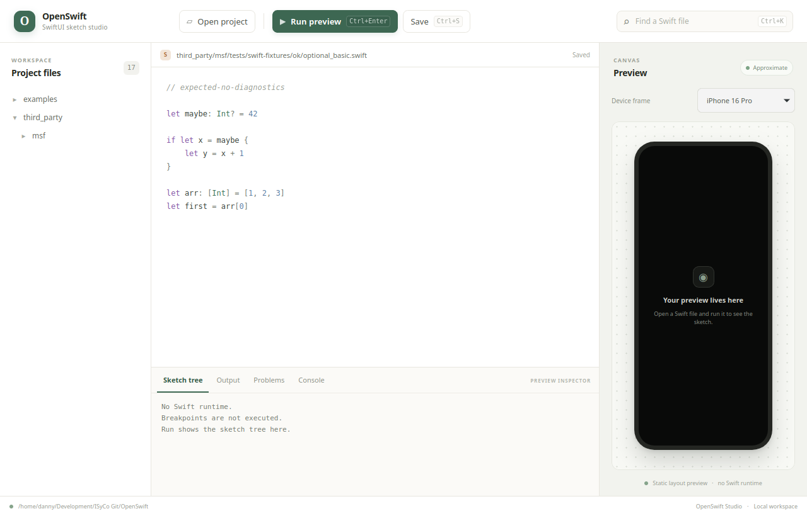

<h1 align="center">OpenSwift</h1>

<p align="center">
  <strong>Una mesa compartida para diseñar una pantalla SwiftUI.</strong><br>
  Un sketch local, una sesión con límites claros y una preview que humanos y agentes pueden revisar juntos.
</p>

<p align="center">
  <a href="#empieza-en-un-minuto">Empieza</a> ·
  <a href="#studio">Studio</a> ·
  <a href="#qué-dibuja">Qué dibuja</a> ·
  <a href="#desarrollo">Desarrollo</a>
</p>

<p align="center">
  
  
  
</p>

---

## Qué es

OpenSwift convierte una parte reconocible de SwiftUI —stacks, texto, botones y algunos modificadores— en un **bosquejo visual** dentro de un marco de iPhone. No compila ni ejecuta Swift. Sirve para hablar de una pantalla y probar cambios de layout sin abrir Xcode.

La pieza central es la sesión `.ui-session`: fija una vista, guarda la intención, registra previews con hashes SHA-256 y, mientras la sesión está activa, limita los guardados de Studio al archivo `target` y a los archivos `allowed`. Así la persona y el agente pueden iterar sobre el mismo objetivo y ver qué cambió.

<p align="center">
  
</p>


## Empieza en un minuto

Necesitas Python 3.10 o posterior. El CLI usa la biblioteca estándar de Python.

```bash
git clone https://github.com/DannyBaanks/OpenSwift.git
cd OpenSwift

# Abre una sesión para el ejemplo incluido
PYTHONPATH="$PWD" python3 -m openswift focus examples/hello.swift \
  --intent "darle más aire al panel"

# Genera la preview y consulta la sesión
PYTHONPATH="$PWD" python3 -m openswift render --device iphone-16-pro
PYTHONPATH="$PWD" python3 -m openswift status
```

Cada render guarda otra iteración en `.ui-session/iterations/`. El PNG sale del mismo SVG que dibuja el Studio (con Chrome/Chromium, `cairosvg`, `rsvg-convert` o `inkscape` si hay alguno instalado; si no, un pintor mínimo integrado, y `status` lo avisa), así que nunca se desfasa del dibujo.

Puedes pedir varios *frames* de una vez; cada uno se acomoda a su propia pantalla:

```bash
PYTHONPATH="$PWD" python3 -m openswift render --device iphone-12,iphone-16-pro,ipad-air-11
PYTHONPATH="$PWD" python3 -m openswift render --device phones --appearance both
```

El primero es la iteración (`001.png`); los demás quedan como `001-<dispositivo>-<look>.png`, junto a una hoja comparativa `001-sheet.png`. En el Studio web, el selector **View** muestra lo mismo en pantalla. La preview actual queda en `.ui-session/preview.png` y su SVG en `.ui-session/preview.svg`.

Para cerrar la sesión, elimina `.ui-session/target.json` cuando ya no necesites el límite de escritura. Los archivos de evidencia de la sesión se conservan.

## Studio

### App de escritorio

La app de escritorio usa Tauri 2, Bun, Rust y Python 3. Desde la raíz del clon:

```bash
cd app
bun install
bun run tauri dev
```

Abre una carpeta de proyecto, elige un archivo `.swift` y pulsa **Run**. **Save** escribe los cambios en el archivo abierto; `Ctrl+S` guarda y `Ctrl+Enter` vuelve a dibujar. La app no ejecuta breakpoints ni compila Swift.

Para compilar los paquetes disponibles en tu plataforma:

```bash
bun run tauri build
```

En Linux se generan los paquetes disponibles, incluido `.deb`, `.rpm` y AppImage. En Windows, Tauri integra `icon.ico` en el ejecutable y usa los paquetes nativos disponibles. La compilación requiere las dependencias nativas de desarrollo de Tauri. Consulta la guía de Tauri para los requisitos de tu sistema.

Descarga los instaladores de escritorio desde [Releases](https://github.com/DannyBaanks/OpenSwift/releases). El release `v0.5` incluye un instalador NSIS `.exe` para Windows, un `.AppImage` para Linux y sus checksums SHA-256.

### Compilar, firmar e instalar (xtool)

La app de escritorio compila, firma e instala sin salir de la ventana usando [xtool](https://github.com/xtool-org/xtool) (MIT). OpenSwift no lo incluye: lo busca en `OPENSWIFT_XTOOL`, `PATH`, `~/.local/bin` o dentro de WSL en Windows, y lo ejecuta en una terminal integrada para que funcionen sus preguntas (Apple ID, contraseña, código 2FA, equipo). Sólo se pueden lanzar acciones de una lista fija, con argumentos validados; no hay un campo libre de comandos, y sólo corre un trabajo a la vez.

Tres pestañas junto a Console:

- **Build**: estado de xtool, del SDK de iOS, de la cuenta y del proyecto; **Set up xtool** (`xtool setup`), **Create project** (`xtool new`), **Build**, **Build + sign .ipa**, **Run on device** e **Install .ipa…**. Necesita un SDK de iOS construido a partir de un Xcode `.xip` que descargas tú desde Apple.
- **Account**: inicio de sesión con Apple ID (`xtool auth login`). La contraseña se envía una sola vez al prompt de xtool; no va en los argumentos, no se muestra en el log ni se guarda, y el campo se limpia al enviar. xtool avisa que este modo usa APIs privadas de Apple: considera un Apple ID secundario.
- **Devices**: lo que Apple tiene registrado para tu cuenta (equipos, certificados, App IDs, dispositivos y perfiles, vía `xtool ds … list`, con la misma sesión de la pestaña Account) y, sobre el dispositivo conectado, **Launch** y **Uninstall** por bundle ID.
- **iLoader**: el motor de [iLoader](https://github.com/nab138/iloader) (`isideload` + `idevice`, MIT) dentro de la ventana, con su **propio** inicio de sesión de Apple aparte del de xtool: instalar un `.ipa` cualquiera, instalar SideStore o LiveContainer + SideStore, colocar el archivo de pairing en las apps que lo piden (o exportarlo), y listar y **revocar** certificados o **borrar** App IDs. Revocar y borrar piden confirmación. El inicio de sesión pasa por un servidor Anisette de terceros (elegible); tus credenciales sólo van a Apple. La clave de firma se guarda en el llavero del sistema o, si no hay, en un archivo de la carpeta de la app. Necesita `usbmuxd` (Linux) o Apple Devices/iTunes (Windows).

Dos sesiones de Apple: xtool (Build, Account, Devices) e iLoader no comparten cuenta ni claves. Si usas la misma Apple ID en ambas, los certificados de desarrollo de una pueden ocupar el cupo de la otra; revocarlos desde iLoader es justo para eso.

**Licencias.** `isideload` trae `apple-codesign-quick` (LGPL-2.1-or-later) enlazado en la app de escritorio; lee [NOTICE.md](NOTICE.md) antes de distribuir builds.

### Studio web local

Desde la raíz de OpenSwift, apunta `PYTHONPATH` al clon y pasa la carpeta del proyecto que quieras abrir:

```bash
OPENSWIFT_DIR="$PWD"
PYTHONPATH="$OPENSWIFT_DIR" python3 -m openswift studio \
  "/ruta/a/tu/proyecto" --port 8765
```

Abre `http://127.0.0.1:8765`. El Studio web incluye selector de dispositivo, modo *Live* (redibuja al escribir), tema claro/oscuro, aviso de cambios sin guardar y un panel **Session** con el objetivo activo. En `examples/` hay pantallas de muestra (`login`, `settings`, `dashboard`). El servidor sólo acepta los hosts locales esperados, bloquea orígenes externos y comprueba que las rutas permanezcan dentro del proyecto. Si hay una `.ui-session/target.json`, también aplica su lista de escritura permitida.

## CLI

```bash
# Dibujar un SVG sin crear sesión
PYTHONPATH="$PWD" python3 -m openswift draw examples/hello.swift \
  --device iphone-15 --output /tmp/hello.svg

# Revisar el árbol como JSON
PYTHONPATH="$PWD" python3 -m openswift sketch examples/hello.swift \
  --device iphone-12

# Modo claro y carcasa distinta, o sólo la pantalla sin marco
PYTHONPATH="$PWD" python3 -m openswift draw examples/dashboard.swift \
  --device iphone-16-pro --appearance light --frame natural --output /tmp/dash.svg

# iPad en horizontal, y la sesión también acepta --appearance/--frame/--orientation
PYTHONPATH="$PWD" python3 -m openswift draw examples/gallery.swift \
  --device ipad-pro-11 --orientation landscape --output /tmp/gallery.svg
PYTHONPATH="$PWD" python3 -m openswift render --device iphone-16 --appearance light --orientation landscape

# Ver las opciones disponibles
PYTHONPATH="$PWD" python3 -m openswift --help
```

Dispositivos incluidos: `iphone-11`, `iphone-12`, `iphone-13`, `iphone-14`, `iphone-14-plus`, `iphone-14-pro`, `iphone-15`, `iphone-15-plus`, `iphone-15-pro`, `iphone-16`, `iphone-16-plus`, `iphone-16-pro` e `iphone-16-pro-max`, más `ipad-10`, `ipad-air-11`, `ipad-pro-11` e `ipad-pro-13`. Con `--orientation landscape` cualquiera se dibuja de lado.

## Qué dibuja

| SwiftUI | Resultado aproximado |
|---|---|
| `VStack`, `HStack`, `ZStack` | Layout básico y espaciado |
| `Text`, `Button` | Texto, tamaño, peso y color básico |
| `Spacer`, `Divider` | Separación y divisor |
| `TextField`, `SecureField`, `Label`, `Image` | Caja etiquetada |
| `Form`, `Section`, `List`, `ScrollView` | Contenedores verticales |
| `NavigationStack`, `Group`, `GroupBox` | Contenedores del sketch |
| `Toggle`, `TextField`, `SecureField`, `Label`, `Image` | Interruptor iOS, campos redondeados, icono marcador |
| Padding, fondo, degradados (`LinearGradient`), `cornerRadius`, `clipShape`, `shadow`, `opacity`, `frame(width:height:maxWidth:)` | Modificadores compatibles del preview |
| `.font(.title…)`, `.fontWeight`, colores del sistema (`.blue`, `.gray`, `.secondary`…), `Color(hex:)`, `.buttonStyle` | Tipografía y color estilo iOS |
| `ForEach` (rangos, arrays literales; si no, 3 copias) y vistas propias del mismo archivo (`Tile()`) | Se expanden con su `body` |
| `Image(systemName:)` / `Label(systemImage:)` | ~20 SF Symbols redibujados (heart, star, bell, house, person, gearshape…); el resto, un icono marcador |
| `.sheet`, bindings, animaciones | No se ejecutan; pueden aparecer como cajas o avisos |

La salida ayuda a conversar sobre composición y proporciones. No representa fielmente el comportamiento, tipografía ni layout final de SwiftUI en iOS.

## Sesiones y límites

Una sesión guarda:

```text
.ui-session/
├── target.json       # objetivo, permitidos, proveedor e iteración
├── intent.md         # objetivo expresado en palabras
├── source.swift      # copia de referencia
├── preview.svg       # último sketch vectorial
├── preview.png       # último sketch rasterizado
├── preview.sha256    # hash de la preview PNG
└── iterations/       # previews anteriores y sus hashes
```

Studio bloquea las escrituras fuera de `target` y `allowed` mientras exista `target.json`. El límite se aplica al guardar desde Studio; no es un sandbox del sistema operativo ni restringe herramientas externas que editen archivos directamente.

## Providers

| Provider | Estado |
|---|---|
| `approximate-web` | Activo; dibuja SVG y PNG localmente |
| `miniswift` | Nombre reservado; todavía no está conectado |
| `xcode-preview` | Nombre reservado; todavía no está conectado |

## Desarrollo

```bash
PYTHONPATH="$PWD" python3 -m unittest discover -s tests
```

El editor puede usar el lexer [msf](https://github.com/toprakdeviren/msf) para colorear Swift. Es opcional: para compilarlo se requiere Git y un compilador C:

```bash
./tools/build-lex.sh
```

El código de msf no está incluido en el repositorio. Está fijado a un commit y su licencia/procedencia se documenta en [NOTICE.md](NOTICE.md).

El icono maestro está en `app/src-tauri/icons/openswift-icon.svg`. Para regenerar los iconos multiplataforma después de editarlo:

```bash
cd app
bun run tauri icon ./src-tauri/icons/openswift-icon.svg --output ./src-tauri/icons
```

## Guías

- [Guía práctica en español](GUIA.md)
- [Aviso de terceros](NOTICE.md)
- [Licencia MIT](LICENSE)

---

<p align="center">Hecho para que humanos y agentes puedan mirar la misma pantalla y hablar de cambios concretos.</p>
